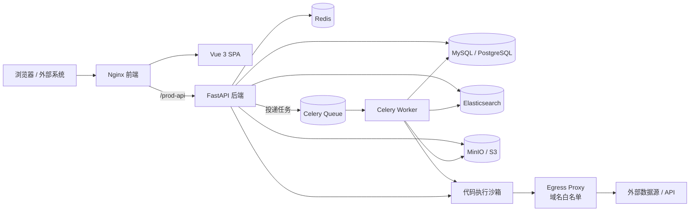

# DataPilot（ezdata）

**一体化数据智能平台**：把「多源数据接入 → 数据开发与调度 → 指标 / 可视化 → AI 应用与知识库 → 告警与治理」收进同一套可私有化部署的系统。

后端基于 **FastAPI + SQLAlchemy 2.0 + Celery**，前端基于 **Vue 3 + Element Plus / Ant Design Vue**，在 [RuoYi-Vue3-FastAPI](https://github.com/insistence/RuoYi-Vue3-FastAPI) 的权限与系统管理底座上扩展出数据平台能力。默认 MySQL，可一键切换 PostgreSQL；提供 Docker Compose 生产 / 开发两套编排、镜像构建 CI 与 Playwright 端到端测试。

---

## 目录

- [核心能力](#核心能力)
- [系统架构](#系统架构)
- [技术栈](#技术栈)
- [仓库结构](#仓库结构)
- [快速开始](#快速开始)
  - [方式一：Docker Compose（推荐）](#方式一docker-compose推荐)
  - [方式二：本地开发](#方式二本地开发)
  - [数据库初始化与迁移](#数据库初始化与迁移)
- [配置说明](#配置说明)
- [命令行工具（ruoyi CLI）](#命令行工具ruoyi-cli)
- [测试与代码质量](#测试与代码质量)
- [CI / 镜像发布](#ci--镜像发布)
- [安全说明](#安全说明)
- [更多文档](#更多文档)
- [许可与致谢](#许可与致谢)

---

## 核心能力

### 1. 多源数据接入与数据开发
- **78+ 数据源连接器**：关系型 / 数仓 / OLAP（MySQL、PostgreSQL、Oracle、SQL Server、ClickHouse、Doris、StarRocks、Snowflake、BigQuery、Databricks…）、时序库、文档库、KV、图库、向量库、消息队列、文件与对象存储、HTTP / OpenAPI 等。
- **统一连接器契约**：读 / 写 / 抽取（dlt）/ 结构探测 / 流式 / 向量 / 接口生成等能力位声明，按需懒加载驱动与连接池。
- **可独立使用的 `ezdata` SDK**：不依赖数据库、租户与加密实现的纯数据访问内核，可被平台、CLI、MCP、Agent 复用（见 [`api/ezdata/README.md`](api/ezdata/README.md)）。
- **数据集成（ETL）**：基于 dlt 的抽取 → 转换 → 装载，支持全量 / 增量、CDC（MySQL binlog）、字段映射与任务化运行。
- **数据资产**：表 / 字段元数据、数据血缘、指标定义、数据访问审计。
- **在线取数**：只读 SQL 护栏、分页预览、结果导出、图表配置生成。

### 2. 任务调度与工作流
- 任务管理、任务模板、**DAG 工作流编排**、执行实例、执行明细日志、Worker 管理。
- **Celery** 分布式执行，Redis 作为 broker；任务日志可落 DB / Elasticsearch / 文件，并通过日志聚合任务统一消费。
- 失败重试、超时控制、并发与队列隔离、文件型任务、定时与手动触发。
- **无状态代码执行沙箱**：Python / Shell / ETL / Transform 调试态在独立容器执行，非 root、drop capabilities、资源上限、独立 internal 网络，出网仅经 **egress 代理域名白名单**。

### 3. AI 应用与知识库（RAG）
- **模型管理**：多供应商（Anthropic、OpenAI、Google、DashScope、DeepSeek、Groq、Ollama、LiteLLM…）、默认 / 兜底模型、Embedding、Rerank。
- **AI 应用**：应用配置、提示词、公开 API（API Key）、流式对话、用量与可观测指标。
- **AI 对话**：多轮会话、SSE 流式输出、工具调用、Markdown / Mermaid / 代码渲染。
- **工具与技能**：内置数据查询、指标、任务、沙箱代码执行、MCP / 多 MCP 工具、技能注册。
- **知识库 RAG**：文档解析（PDF / DOCX / PPTX / HTML / Markdown…）、语义切分、上下文增强、Embedding、Elasticsearch 向量库、混合检索与重排。
- **安全护栏**：Guardrails、调用可观测、令牌与数据范围隔离。

### 4. 可视化与指标
- 控制台仪表盘、可编辑看板 / 分组、分享参数、大屏可视化。
- ECharts 图表构建器、AI 生成图表配置（`chart_spec` JSON），支持自助分析。
- 指标服务与图表数据接口。

### 5. 告警中心
- 告警策略（阈值 / 任务状态等）、告警记录、静默与恢复。
- 多通道转发：**Webhook / Kafka / Email / 系统通知 / 企业微信 / 飞书 / 钉钉**，渠道可注册扩展；单个渠道失败不影响其他渠道。

### 6. 平台治理与系统管理
- RBAC 权限、部门 / 岗位 / 角色 / 菜单 / 数据范围、字典、参数配置、通知公告、操作日志、登录日志、在线用户、缓存监控、服务监控。
- **多租户**：用户-租户成员模型、租户上下文隔离、存量数据回填。
- **文件管理**：统一文件与对象存储（MinIO / S3 / OSS / Azure Blob / GCS / COS），文件维护任务、访问权限与回收。
- **API 令牌**：通用 API Token，供外部系统调用平台开放接口。
- **GitHub SSO**：OAuth 登录、组织白名单、自动建号与默认角色。
- **传输加密**：RSA 密钥协商 + AES 报文加密，支持密钥轮换与公钥导出。
- **限流、数据范围、预授权、接口鉴权**等通用切面。

### 7. 开发者体验
- **`ruoyi` CLI**（Typer）：应用运行 / 路由 / 配置、数据库迁移、缓存、参数、定时任务、代码生成、运维健康检查。
- **TUI**（Textual）：交互式浏览任务、缓存、配置与数据库状态。
- **Shell 自动补全**：Bash / Zsh / Fish / PowerShell。
- **交互式向导**：数据库升级、缓存清理、代码导出、应用运行、生产检查等。
- **代码生成器**：导入物理表，一键生成前后端 CRUD。

---

## 系统架构



- **前端**：Vue 3、Vite 6、Pinia、Vue Router、Element Plus、Ant Design Vue、ECharts / G2Plot、X6、Monaco、Mermaid、KaTeX。
- **后端**：FastAPI 0.128、SQLAlchemy 2（async）、Alembic、Pydantic 2、Celery 5、APScheduler、Agno、litellm、dlt。
- **中间件**：MySQL 8 / PostgreSQL 14、Redis、Elasticsearch 8、MinIO。
- **部署**：Docker Compose（生产 `docker-compose.yml` / 开发 `docker-compose.dev.yml`）、Nginx、GitHub Actions。

---

## 技术栈

| 层次 | 主要技术 |
|---|---|
| 前端 | Vue 3.5、Vite 6、Pinia、Element Plus、Ant Design Vue、ECharts、AntV X6、Monaco、Mermaid |
| Web 框架 | FastAPI、Uvicorn、Starlette、Pydantic v2 |
| 数据访问 | SQLAlchemy 2.0 async、Alembic、PyMySQL / asyncmy、asyncpg |
| 异步任务 | Celery、Redis、APScheduler |
| AI / RAG | Agno、litellm、Anthropic / OpenAI / Google / DashScope 等 SDK、Elasticsearch 向量检索、dlt |
| 存储 | MinIO / S3、本地文件、多种云对象存储 |
| 质量保障 | Ruff、Pytest、Playwright、GitHub Actions |
| 运行环境 | Python 3.10+、Node.js 18+、Docker / Docker Compose |

---

## 仓库结构

```
.
├── api/                        # FastAPI 后端
│   ├── app.py / server.py      # 应用入口与工厂
│   ├── cli/                    # ruoyi CLI / TUI / 补全 / 交互向导
│   ├── common/                 # 通用切面、注解、上下文、路由、指标
│   ├── config/                 # 环境、数据库、Redis、Celery、调度器
│   ├── module_admin/           # 系统管理（用户/角色/菜单/部门/字典/日志/文件/缓存…）
│   ├── module_ai/              # AI 模型 / 应用 / 对话 / 技能 / 工具 / 指标
│   ├── module_alert/           # 告警策略 / 记录 / 多通道转发
│   ├── module_apitoken/        # 通用 API 令牌
│   ├── module_dashboard/       # 控制台统计
│   ├── module_data/            # 数据源 / 数据资产 / ETL / 指标 / 血缘
│   ├── module_generator/       # 代码生成器
│   ├── module_rag/             # 知识库 / 切分 / 向量化 / 检索 / 重排
│   ├── module_task_schedule/   # 任务 / 模板 / DAG / 实例 / 日志 / Worker / CDC
│   ├── ezdata/                 # 可独立复用的数据访问 SDK + 78+ 连接器
│   ├── alembic/                # 数据库迁移
│   ├── sql/                    # MySQL / PostgreSQL 初始化脚本
│   ├── sandbox_app.py          # 无状态代码执行沙箱
│   └── requirements*.txt       # Python 依赖
├── web/                        # Vue 3 前端
│   ├── src/views/              # 系统 / 数据 / AI / RAG / 任务 / 告警 / 监控 / 工具
│   ├── src/api/                # 接口封装
│   ├── bin/                    # Nginx 配置
│   └── vite.config.js
├── tests/                      # Pytest + Playwright 端到端测试
├── deploy/                     # 密钥生成、备份、egress 代理
├── docker-compose.yml          # 生产编排（MySQL 默认 / PG 切换）
├── docker-compose.dev.yml      # 开发编排（热更新）
├── .env.example                # 生产环境变量模板
├── .env.pg                     # PostgreSQL 切换包
└── .github/workflows/          # 镜像构建、Ruff、Playwright
```

---

## 快速开始

### 方式一：Docker Compose（推荐）

前置：Docker 24+ 与 Docker Compose v2。

```bash
# 1. 生产编排（默认 MySQL，零配置可启动）
cp .env.example .env        # 可选：按需修改端口、口令、AI Key 等
docker compose up -d

# 2. 切换 PostgreSQL
docker compose --env-file .env.pg up -d
```

默认访问：

| 服务 | 地址 |
|---|---|
| 前端 | http://localhost（`FRONTEND_PORT` 可改） |
| 后端 Swagger | http://localhost:19099/docs |
| MinIO 控制台 | http://localhost:19001 |

> ⚠️ 首次部署请务必修改 `.env` 中的数据库 / Redis / ES / MinIO 口令与应用密钥；可使用 `python deploy/gen-secrets.py --env dockermy` 一次性生成互相对齐的随机密钥。

开发模式（源码挂载 + 后端热重载 + Vite HMR）：

```bash
docker compose -f docker-compose.dev.yml up --build   # 首次或依赖变更
docker compose -f docker-compose.dev.yml up           # 日常
```

- 前端：http://localhost
- 后端 Swagger：http://localhost:9099/docs

### 方式二：本地开发

后端（Python 3.10+）：

```bash
cd api
python -m venv .venv && source .venv/bin/activate    # Windows: .venv\Scripts\activate
pip install -r requirements.txt
pip install -r requirements-data.txt                  # 可选：ETL / 数据源驱动
cp .env.dev.example .env.dev                          # 填入数据库、Redis、密钥等
python app.py --env=dev
```

前端（Node.js 18+）：

```bash
cd web
npm install
npm run dev
```

默认后端端口 `9099`，前端通过 `/dev-api` 代理到后端。

### 数据库初始化与迁移

- Docker：首次启动自动导入 `api/sql/ezdata.sql`（MySQL）或 `api/sql/ezdata-pg.sql`（PostgreSQL）。
- 本地 / 已有库：使用 Alembic 升级到最新版本。

```bash
cd api
alembic upgrade head
# 或使用 CLI
ruoyi db upgrade
ruoyi db current
ruoyi db revision -m "add_xxx" --autogenerate
```

---

## 配置说明

配置优先级：**命令行 `--env` > 已存在的环境变量（Compose 注入）> `api/.env.<APP_ENV>` > 代码默认值**。

| 配置组 | 关键变量 | 说明 |
|---|---|---|
| 应用 | `APP_ENV` `APP_NAME` `APP_PORT` `APP_ROOT_PATH` `APP_WEB_BASE_URL` | 运行环境、端口、代理前缀、外链基址 |
| 安全 | `JWT_SECRET_KEY` `DATA_ENCRYPT_KEY` | Token 签名、库内凭据加密（Fernet） |
| 数据库 | `DB_TYPE` `DB_HOST` `DB_PORT` `DB_USERNAME` `DB_PASSWORD` `DB_DATABASE` | 支持 `mysql` / `postgresql` |
| Redis | `REDIS_HOST` `REDIS_PORT` `REDIS_PASSWORD` `REDIS_DATABASE` | 缓存、Token、Celery broker |
| Elasticsearch | `TASK_ES_*` `RAG_VECTOR_*` | 任务日志、RAG 向量库 |
| 对象存储 | `STORAGE_TYPE` `S3_*` / `MINIO_*` | MinIO、S3、OSS、Azure、GCS、COS |
| AI | `LLM_*` `EMBEDDING_*` `RERANK_*` `DASHSCOPE_API_KEY` | 兜底模型、向量化、重排 |
| 沙箱 | `SANDBOX_ENABLED` `SANDBOX_BEARER_KEY` `SANDBOX_EGRESS_ALLOW` | 沙箱鉴权与出网域名白名单 |
| SSO | `GITHUB_SSO_*` | GitHub OAuth 登录 |
| 传输加密 | `TRANSPORT_CRYPTO_*` | RSA/AES 报文加密开关与密钥 |

完整变量清单见 [`.env.example`](.env.example)、`api/.env.dev.example`、`api/.env.prod.example`。

---

## 命令行工具（ruoyi CLI）

安装（在 `api/` 下）：

```bash
pip install -e .
ruoyi --help
```

常用命令：

```bash
# 应用
ruoyi app run --env=dev          # 启动 FastAPI
ruoyi app doctor                 # 启动前自检
ruoyi app routes                 # 查看路由清单
ruoyi app config                 # 查看配置快照

# 数据库迁移
ruoyi db check
ruoyi db upgrade --revision head
ruoyi db current
ruoyi db history

# 缓存 / 参数 / 定时任务
ruoyi cache stats
ruoyi cache clear --cache-name sys_config
ruoyi config list
ruoyi config set --config-key demo.key --value demo
ruoyi job list
ruoyi job run-once --job-id 1

# 运维 / 开发
ruoyi ops health
ruoyi ops ping-db
ruoyi ops ping-redis
ruoyi dev lint --fix
ruoyi dev test -k login

# 代码生成
ruoyi gen db-list
ruoyi gen import-table sys_user

# 交互式向导 / TUI / 自动补全
ruoyi wizard --help
ruoyi tui
ruoyi completion install --shell powershell
```

---

## 测试与代码质量

```bash
# 后端静态检查（CI 同步执行）
ruff check api tests
ruff format api tests --check

# 后端测试
cd tests
pip install -r requirements.txt
playwright install
python -m pytest -v

# 或使用 CLI
ruoyi dev lint
ruoyi dev test
```

端到端测试覆盖登录、受保护路由重定向、页面巡检、任务告警、多租户等场景，详见 [`tests/README.md`](tests/README.md)。

---

## CI / 镜像发布

| Workflow | 触发 | 内容 |
|---|---|---|
| `build-images.yml` | 推送 `v*` tag / 手动触发 | 构建并推送后端（MySQL）、前端镜像到 Docker Hub |
| `ruff.yml` | push / PR 到 `master` | Ruff 检查与格式校验 |
| `playwright.yml` | 按配置触发 | Playwright 端到端测试 |

镜像相关 Secrets：`DOCKERHUB_USERNAME`、`DOCKERHUB_TOKEN`。

---

## 安全说明

- 仓库只提交 `.example` 模板；`.env`、`api/.env.dev`、`api/.env.prod`、`api/.env.dockermy`、`api/.env.dockerpg` 等真实配置已被 `.gitignore` 排除。
- 生产部署请务必替换 Compose 默认口令，并设置强随机 `JWT_SECRET_KEY`、`DATA_ENCRYPT_KEY`。
- 沙箱容器运行于 `internal` 网络，默认无公网出口；如需访问外部数据源，请通过 `SANDBOX_EGRESS_ALLOW` 精确配置域名白名单。
- 开放 API 使用 API Token 鉴权；建议配合限流、IP 白名单与最小权限角色使用。
- 若需公开仓库，请再次确认历史提交与配置文件中不含任何真实凭据。

---

## 更多文档

- 数据访问 SDK：[`api/ezdata/README.md`](api/ezdata/README.md)
- 数据源连接器清单：[`api/ezdata/handlers/README.md`](api/ezdata/handlers/README.md)
- 测试套件：[`tests/README.md`](tests/README.md)
- 轻量查数 UI：[`api/ezdata/interface/web/README.md`](api/ezdata/interface/web/README.md)
- 接口文档：启动后端后访问 `/docs` 或 `/redoc`

---

## 许可与致谢

- 前端与系统管理底座源自 [RuoYi-Vue3-FastAPI](https://github.com/insistence/RuoYi-Vue3-FastAPI) / [RuoYi-Vue3](https://github.com/yangzongzhuan/RuoYi-Vue3)，遵循 MIT License（见 [`web/LICENSE`](web/LICENSE)）。
- 数据平台、AI / RAG、任务调度、沙箱与连接器等扩展能力由本项目维护。
- 感谢所有上游开源项目与贡献者。

如用于商业或生产环境，请自行评估并遵守各依赖组件的许可协议。
